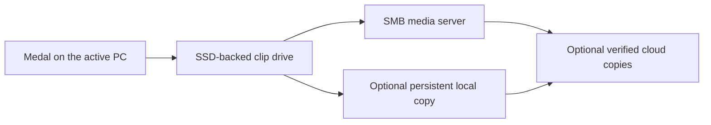

# Medal Sync

[](https://github.com/Larson-Logan/medal-sync/actions/workflows/validate.yml)
[](https://github.com/Larson-Logan/medal-sync/releases/latest)
[](LICENSE)

**Your Medal recordings, on your storage.** Medal Sync is a Windows companion
for [Medal](https://medal.tv) that records to a fast SSD cache, keeps your clip
library on your own server or disk, and can copy it to OneDrive, Dropbox or
Google Drive. Move between gaming PCs with one shared library, while each PC
keeps its own Medal login and recording settings.

**[Download for Windows](https://github.com/Larson-Logan/medal-sync/releases/latest)** ·
[Getting started](docs/getting-started.md) ·
[Storage guide](docs/storage.md) ·
[Commands](docs/commands.md) ·
[Configuration](docs/configuration.md) ·
[Get help](SUPPORT.md)

> [!WARNING]
> Medal Sync is experimental software for Windows x64. Keep an independent
> backup of your clips. A synced library and a cache are not a backup.

## What it does

- **Records at SSD speed.** Medal writes to a virtual clip drive backed by a
  local SSD cache. Clips upload in the background.
- **Keeps the library on your storage.** Store clips on an SMB server, a
  persistent local folder, or any rclone remote.
- **Adds cloud copies if you want them.** Send verified copies to OneDrive,
  Dropbox, Google Drive or several named rclone destinations.
- **Hands the library between PCs safely.** One PC owns the library at a time.
  Clip records are shared; logins, microphone and encoder settings are not.
- **Verifies before it lets go.** Uploads are checked on the server before
  another PC can take over. Anything uncertain stops and waits for you.

## How it works



1. You start Medal through Medal Sync. It takes ownership of the library and
   mounts the clip drive.
2. Medal records to the drive as usual. New files upload in the background.
3. When you quit Medal, Medal Sync finishes uploads, verifies every required
   copy, checks the library and releases ownership. The status shows **Ready**.
4. Another PC can now start Medal and pick up the same library.

If something is interrupted, the PC keeps ownership and its local media so the
next launch can retry. Nothing is handed off until it is verified.

## Choose where your recordings live

| Storage | How it works |
| --- | --- |
| Server with SSD cache | Record through a cached virtual drive; the collection lives on your SMB server. |
| Local copy and server | Keep a complete collection on a local disk and upload it to the server before switching PCs. |
| Local storage only | Keep media and coordination on one PC. No server needed. |
| Cloud or personal-server primary | Use any rclone remote as primary storage, with a persistent local copy and an SMB journal. |
| Google Drive without a server | Keep a local recording copy; use Drive for media, library history and cross-PC ownership. |
| Cloud copies (add-on) | Add OneDrive, Dropbox, Google Drive or other rclone destinations to any mode. |

Server modes and Google Drive cloud mode share the library between PCs. Local
storage only stays on one PC. [Google Drive cloud setup](docs/storage.md#google-drive-without-a-server)
requires no SMB server.
The [storage guide](docs/storage.md) explains each mode, drive and file system
requirements, and how to set them up.

## Get started

**You'll need:** Windows x64, [Medal](https://medal.tv), a local SSD (NTFS,
ReFS or exFAT) and, for server modes, an SMB share every PC can reach. Setup
includes .NET and rclone, and offers the WinFsp driver.

1. **Install.** Download the **Windows x64 setup EXE** from
   [Releases](https://github.com/Larson-Logan/medal-sync/releases/latest).
   Choose per-user or all-users installation. All-users setup can install
   the bundled WinFsp driver.
2. **Check compatibility.** Run `medal-sync.exe compatibility` to confirm your
   installed Medal version and database are supported.
3. **Configure.** Open **Medal Sync Setup Guide** from the Start menu, or
   launch Medal Sync and follow the configuration wizard. It previews every
   setting before saving. [Getting started](docs/getting-started.md) walks
   through creating or joining a library, and includes a prompt for letting an
   AI coding agent prepare the configuration with you.
4. **Record.** Launch Medal through Medal Sync. After you quit Medal, wait for
   **Ready** before switching PCs, updating or uninstalling.

Setup does not create a library, mount storage or change Medal's startup
entries on its own. Those happen only when you configure them.

## Updates and removal

Medal Sync checks for new releases when it starts and offers to run the
verified installer. Nothing installs without your confirmation. Use
**Check for Medal Sync updates** in the Start menu for a manual check.

Before updating or uninstalling, quit Medal, wait for **Ready**, then choose
**Exit Medal Sync** in the status panel or tray menu. Repair and removal are in
Windows **Installed apps**. A portable ZIP is also available for advanced use.
See [installation, updates and removal](docs/updates.md) for checksum
verification and recovery.

## Limits

- **Serial handoff only.** One PC owns the library at a time. Server modes use
  an SMB coordination share; Google Drive cloud mode uses conditional API
  updates. Local storage only does not hand off between PCs.
- **No deletion sync.** Deleting a clip is not propagated to other copies.
  Cloud copies keep older files. Destination conflicts stop by default;
  optional versioned updates keep the previous file before replacing it.
- **Private data stays private.** Provider credentials, Medal logins and full
  Medal databases are never copied to shared storage or cloud copies. Cloud
  mode stores normalized library snapshots and history in the private Drive folder.
- **Conservative by design.** Unknown database schemas, uncertain uploads and
  unreviewed removals stop handoff and keep ownership and the cache.
- **Testing.** Automated tests use synthetic data. Real provider sign-in,
  playback, reboot and cross-PC handoff are checked separately on real PCs.

## Development

You'll need Windows, PowerShell 7, the .NET SDK pinned in
[global.json](global.json), Node 24 and Python 3.11+. Tests use synthetic
databases and isolated scratch folders; no credentials or real Medal library
are needed.

```powershell
pwsh -File scripts/validate.ps1                   # full test suite
pwsh -File scripts/package-windows-installer.ps1  # build the setup EXE
```

- `scripts/test-storage-integration.ps1` runs real rclone and WinFsp tests
  against synthetic libraries and local test remotes.
- `scripts/test-windows-installer-isolated.ps1` tests native installation with
  its own registration, shortcuts and readiness probe.
- Builds and packages go to the ignored `.medal-sync-dist/` folder.

**Branches and releases.** Work lands on `dev` first, and only `dev` merges
into `main`, so `main` always works. Windows CI validates every pull request
and checks native install, repair and uninstall. Each merge to `main`
publishes a release tagged `vMAJOR.MINOR.PATCH.NN`, where `NN` counts hotfixes
since the last version bump.

More: [contributing](CONTRIBUTING.md) · [local development](docs/local-development.md) ·
[tests](tests/README.md) · [changelog](CHANGELOG.md) ·
[release process](docs/releases.md) · [versions and schemas](docs/versioning.md) ·
[security](SECURITY.md) · [third-party dependencies](THIRD_PARTY.md)

## Help and contributing

- **Questions or problems:** read the [support guide](SUPPORT.md), then
  [open an issue](https://github.com/Larson-Logan/medal-sync/issues/new/choose).
  Use synthetic examples and keep private library files out of reports.
- **Code or docs changes:** read [contributing](CONTRIBUTING.md), open a
  focused pull request against `dev`, and include validation results.
  Maintainers follow the [triage and review guide](docs/triage.md).
- Please follow the [code of conduct](CODE_OF_CONDUCT.md).

## License

[MIT](LICENSE). Dependencies keep their own licenses; see
[third-party dependencies](THIRD_PARTY.md).

Medal Sync is an independent project, not affiliated with Medal, Microsoft,
Dropbox or Google.
