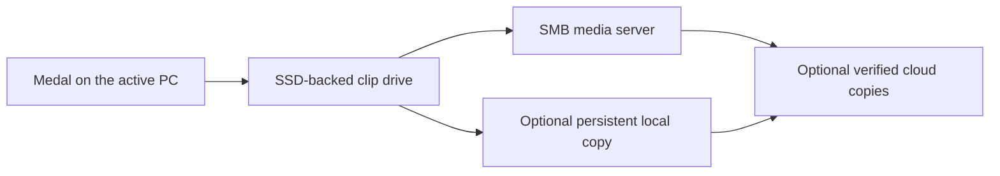

# Medal Sync

[](https://github.com/Larson-Logan/medal-sync/actions/workflows/validate.yml)
[](LICENSE)

**Your Medal recordings, on your storage.** A Windows companion for
[Medal](https://medal.tv) with SSD caching, persistent local copies, verified
server uploads, and optional OneDrive, Dropbox and Google Drive replicas.
Switch between PCs while each keeps its own login and recording settings.

[Download Windows setup](https://github.com/Larson-Logan/medal-sync/releases) ·
[Getting started](docs/getting-started.md) · [Storage guide](docs/storage.md) ·
[Report an issue](https://github.com/Larson-Logan/medal-sync/issues)

## Choose where your recordings live

| Storage | How it works |
| --- | --- |
| Server + SSD cache | Record through a cached virtual drive; keep the collection on your SMB server. |
| Local copy + server | Record to persistent local storage; upload and verify on the server before switching PCs. |
| Cloud replicas | Add OneDrive, Dropbox, Google Drive, or multiple named rclone destinations to either mode. |



One PC owns the library at a time. After Medal exits, the companion drains
writes, verifies required copies, checks the library, and releases ownership.
An interruption retains ownership and local media so the next launch can retry.
Persistent local media survives finished-session cache cleanup.

## Install and configure

1. Download the **Windows x64 setup EXE** from
   [Releases](https://github.com/Larson-Logan/medal-sync/releases) when a
   maintainer publishes a release. The wizard offers per-user or all-users
   installation, Start menu shortcuts, repair, upgrades and removal through
   Windows **Installed apps**.
2. Open the included **Medal Sync Setup Guide**. Install rclone and WinFsp,
   then follow [getting started](docs/getting-started.md) to preview configuration
   and enroll a library. The companion executables already include .NET.
3. Choose [storage options](docs/storage.md). Add `--local-copy-root` to retain
   a complete local collection; add `--cloud-remote` and `--rclone-config` for a
   provider authorized through rclone. Several providers can be configured in JSON.
4. Launch through Medal Sync. After quitting Medal, wait for **Ready** before
   switching PCs, updating or uninstalling.

The advanced portable ZIP is available alongside setup. See
[installation, updates and removal](docs/updates.md) for checksum verification
and recovery. Desktop launches check for newer published releases with a
short network budget; updates require an explicit installation request.

## Current limits

**Experimental software for Windows x64. Keep an independent media backup.**
An SMB coordination share remains required, including when keeping a local
copy or using cloud replicas. Cloud copies contain referenced media, and are
additive: destination conflicts require review and deletions are not propagated.
Provider credentials, Medal logins and full databases stay outside those copies.

Unknown schemas, uncertain uploads and unreviewed removals stop handoff and
retain ownership and cache. Synthetic tests are separate from real provider
sign-in, playback, physical reboot and cross-PC acceptance. Medal Sync is an
independent project, unaffiliated with Medal, Microsoft, Dropbox or Google.

## Development

Use Windows, PowerShell 7, .NET SDK 10.0.202 (global.json), Node 24 and
Python 3.11+. Tests use synthetic databases and isolated scratch directories;
no credentials or live Medal library are needed.

```powershell
pwsh -File scripts/validate.ps1
pwsh -File scripts/package-windows-installer.ps1
```

Builds and packages go into ignored `.medal-sync-dist/`. Windows CI validates
pull requests and main, builds the installer, and checks native installation,
repair and uninstall on an ephemeral runner. Release tags create drafts for
maintainer review.

- [Contributing](CONTRIBUTING.md), [local development](docs/local-development.md),
  [tests](tests/README.md) and [changelog](CHANGELOG.md)
- [Release process](docs/releases.md), [security](SECURITY.md) and
  [third-party dependencies](THIRD_PARTY.md)

Licensed under the [MIT license](LICENSE). Dependencies retain their own licenses.
